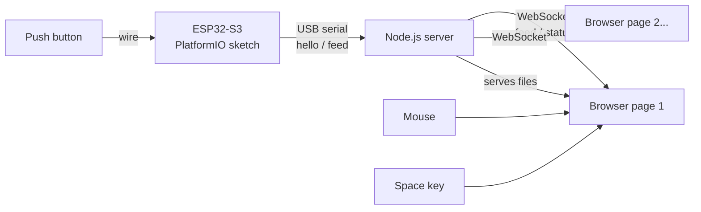
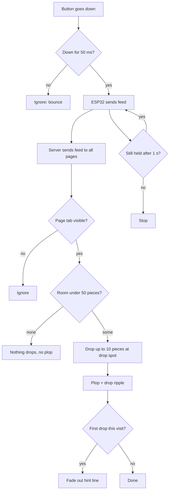
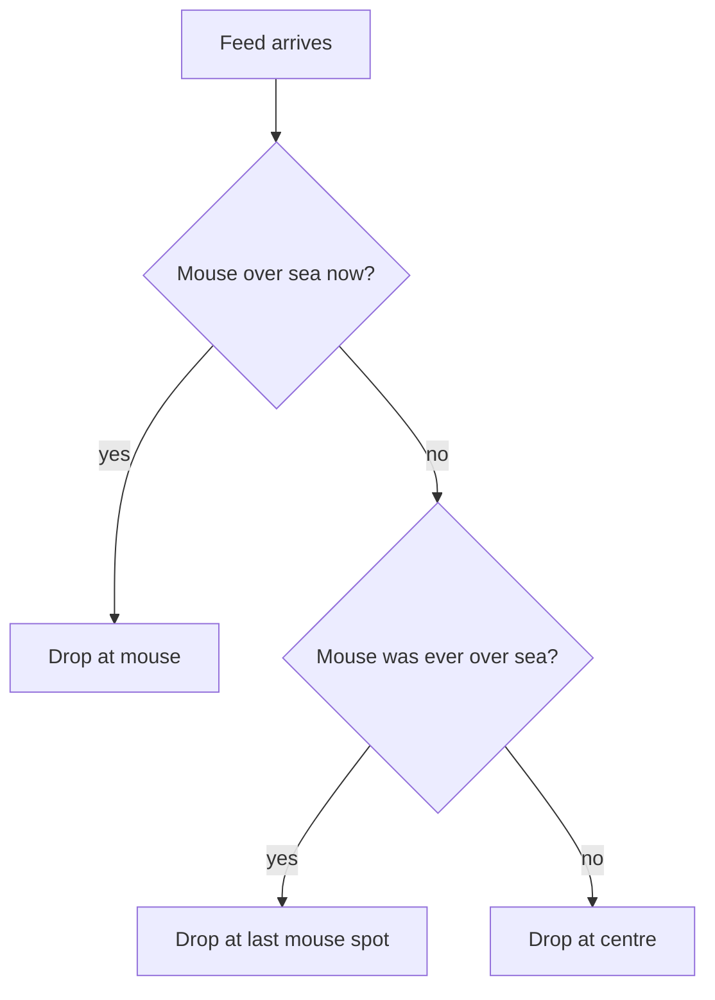
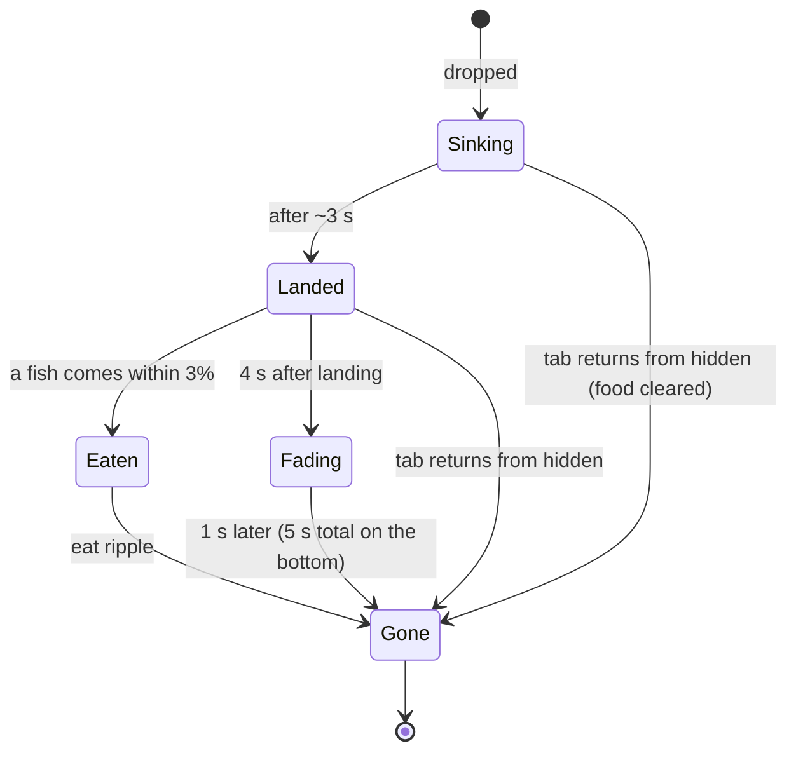
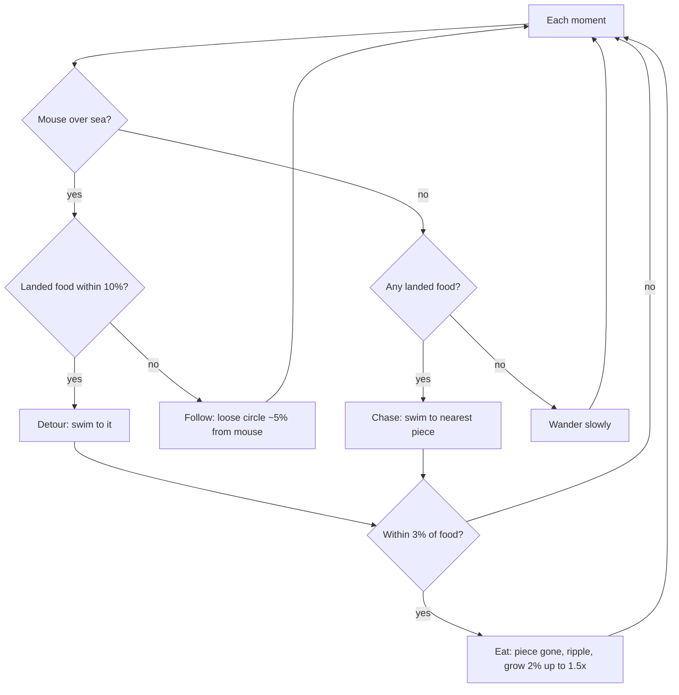
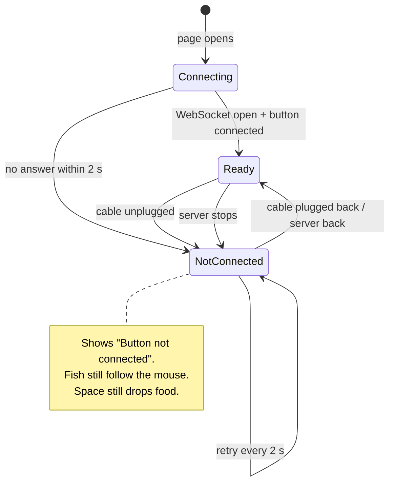
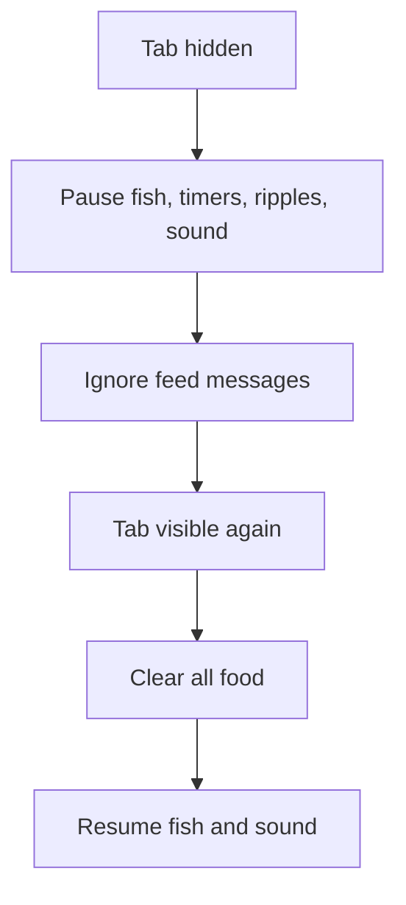

# 04 — Flow Charts

These charts are written in Mermaid, which VS Code, GitHub and many Markdown viewers draw as diagrams. Each chart has a short explanation under it.

## 1. The whole system

The button talks to the ESP32. The ESP32 talks to the server over USB, and the server talks to every open page. The mouse and the Space key go straight to the page.

## 2. One button press

Holding the button repeats the feed every second. The page decides how many pieces fit under the limit.

## 3. Where food drops

## 4. Life of one food piece

Fish cannot eat a piece while it is sinking. Once it lands, it lasts 5 seconds and fades out during its last second.

## 5. What each fish does

## 6. Connection status on the page

## 7. Tab hidden and shown

